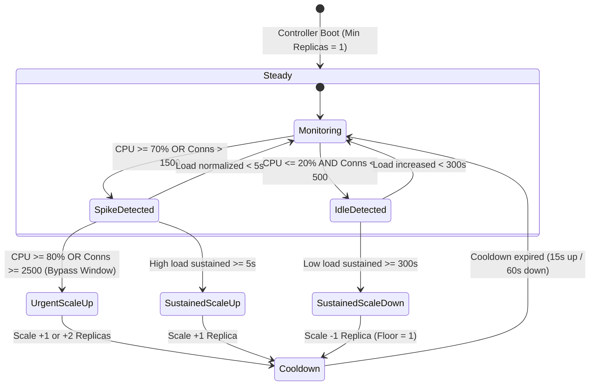

# Dynamic Autoscaling & Capacity Control - Lynk

> **Authoritative Specification: Single-Host Dynamic Autoscaler**
> **Component Path:** `deploy/autoscaler/controller.py`
> **Test Suite:** `deploy/autoscaler/test_controller.py` (12 unit tests)
> **Orchestrator:** Docker Compose Engine (`/var/run/docker.sock`)
> **Control Plane Target:** `lynk-api` service (Go REST API backend)

---

## 1. System Overview

Lynk operates on a single-server, high-density architecture orchestrated via Docker Compose. Under heavy campus load spikes (such as course enrollment rushes or hackathon project deadlines), traffic can surge rapidly.

Rather than relying on distributed orchestration overhead, Lynk implements an in-repo, autonomous scaling daemon (`deploy/autoscaler/controller.py`) that monitors live container metrics, evaluates load thresholds, dynamically adjusts the Go API replica count (`docker compose up -d --scale api=N --no-recreate`), and signals the Nginx reverse proxy gateway to reload upstream targets without dropping in-flight sockets.

```text
+-------------------------------------------------------------------------+
|                              Host Machine                               |
|                                                                         |
|  +--------------------+        Polls        +------------------------+  |
|  |   lynk-gateway     | <------------------ |    lynk-autoscaler     |  |
|  |  (Nginx 1.25)      |                     | (controller.py daemon) |  |
|  |  /nginx_status     |                     +------------------------+  |
|  +--------------------+                                 |               |
|            |                                            | Evaluates     |
|            | Upstream Balance                           v               |
|            v                                 +------------------------+  |
|  +--------------------+                      |   Docker Socket        |  |
|  | lynk-api Replicas  | <------------------- |  /var/run/docker.sock  |  |
|  |  (1 to 4 replicas) |   Scales Container   +------------------------+  |
|  +--------------------+   via Docker Compose                            |
+-------------------------------------------------------------------------+
```

---

## 2. Core Operational Metrics & Triggers

The autoscaler daemon evaluates three telemetry inputs on every control tick (`AUTOSCALE_CHECK_INTERVAL=5s`):

1. **Per-Replica Container CPU Utilization:**
   - Samples `/sys/fs/cgroup/cpu` or Docker stats.
   - Computes `avg_cpu = total_cpu_percent / current_replicas`.
   - Scale-up trigger: `avg_cpu >= 70.0%` sustained for 5 seconds.
   - Double-step scale-up trigger: `avg_cpu >= 85.0%`.
   - Scale-down trigger: `avg_cpu <= 20.0%` sustained for 300 seconds (5 minutes).

2. **Active Socket Concurrency (Nginx Gateway):**
   - Polls `http://lynk-gateway:8080/nginx_status` reading live `Active connections`.
   - Computes `conns_per_replica = active_connections / current_replicas`.
   - Scale-up trigger: `conns_per_replica > 1500` sustained.
   - Double-step trigger: `conns_per_replica >= 3000`.

3. **Host Memory Safety Guard (RAM Floor Protection):**
   - Reads host available memory before every scaling decision.
   - Invariant: Host memory headroom must remain >= `HOST_MEM_HEADROOM_PERCENT` (default: 20%).
   - If available RAM falls below the safety threshold, all scale-up actions are blocked to prevent kernel Out-Of-Memory (OOM) reaper kills on PostgreSQL, Redis, or Nginx.

---

## 3. Scale Action State Machine & Cooldowns



### 3.1 Urgent Spike Fast-Path
Under severe traffic bursts (e.g., sudden DDoS or viral campus link), waiting for a sustained time window risks queue exhaustion. The controller detects urgent conditions:
- `avg_cpu >= 80.0%`
- `conns_per_replica >= 2500`
- `rps_per_replica >= 100`

When an urgent condition is flagged, the controller bypasses the 5-second sustained window and scales up immediately.

### 3.2 Cooldown Periods
To prevent thrashing (rapid oscillation between scaling up and down):
- **Scale-Up Cooldown:** 15 seconds (`SCALE_UP_COOLDOWN_SEC=15`).
- **Scale-Down Cooldown:** 60 seconds (`SCALE_DOWN_COOLDOWN_SEC=60`).
- **Scale-Down Sustained Window:** 300 seconds (`SCALE_DOWN_SUSTAINED_SEC=300`) ensuring temporary lulls do not trigger premature de-provisioning.

---

## 4. Non-Disruptive Gateway Dynamic Reload

When the replica count changes:
1. The autoscaler executes:
   ```bash
   docker compose up -d --scale api=N --no-recreate
   ```
2. Once new container instances pass their healthcheck (`GET /readyz`), Nginx upstream resolution is triggered via:
   ```bash
   docker exec lynk-gateway nginx -s reload
   ```
3. Nginx reloads its configuration gracefully: active worker processes finish serving existing keep-alive sockets, while new worker processes bind immediately to the expanded replica set.

---

## 5. Configuration & Environment Variables

| Variable Name | Default | Purpose |
| :--- | :--- | :--- |
| `AUTOSCALE_ENABLED` | `true` | Enables/disables dynamic autoscaling controller |
| `AUTOSCALE_MIN_REPLICAS` | `1` | Minimum API container replica floor |
| `AUTOSCALE_MAX_REPLICAS` | `4` | Maximum API container replica ceiling |
| `AUTOSCALE_CHECK_INTERVAL` | `5` | Metric sampling interval in seconds |
| `SCALE_UP_CPU_PERCENT` | `70.0` | CPU threshold to initiate scale-up window |
| `SCALE_DOWN_CPU_PERCENT` | `20.0` | CPU threshold to initiate scale-down window |
| `SCALE_UP_SUSTAINED_SEC` | `5` | Required duration of high load before scaling up |
| `SCALE_DOWN_SUSTAINED_SEC` | `300` | Required duration of low load before scaling down |
| `SCALE_UP_COOLDOWN_SEC` | `15` | Cooldown period following a scale-up action |
| `SCALE_DOWN_COOLDOWN_SEC` | `60` | Cooldown period following a scale-down action |
| `HOST_MEM_HEADROOM_PERCENT` | `20.0` | Minimum host free RAM percentage required to allow scale-up |
| `AUTOSCALER_LOG_FILE` | `tests/load/results/autoscaler_events.log` | Persistent log file for scaling audit events |

---

## 6. Verification & Automated Testing

The autoscaler is comprehensively tested by `deploy/autoscaler/test_controller.py`:
- `test_normal_load_steady`: Verifies no scaling when metrics remain within normal bounds.
- `test_cpu_scale_up_sustained`: Validates scaling after 5s sustained CPU > 70%.
- `test_urgent_scale_up_bypass`: Validates immediate scale-up on CPU >= 80%.
- `test_connection_surge_scale_up`: Validates scaling on active socket surges (> 1500 conns/replica).
- `test_double_step_scale_up`: Validates step increase of 2 replicas under extreme saturation.
- `test_host_memory_safety_floor`: Validates scale-up refusal when host free RAM is below 20%.
- `test_scale_down_sustained_window`: Validates that scale-down requires full 300s low load.
- `test_cooldown_enforcement`: Validates rejection of new scaling decisions during cooldown.
